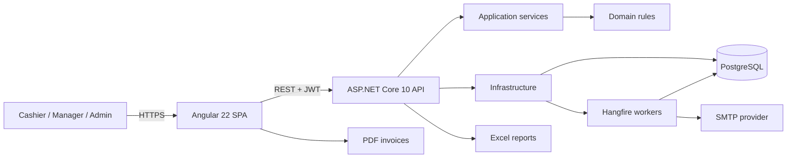
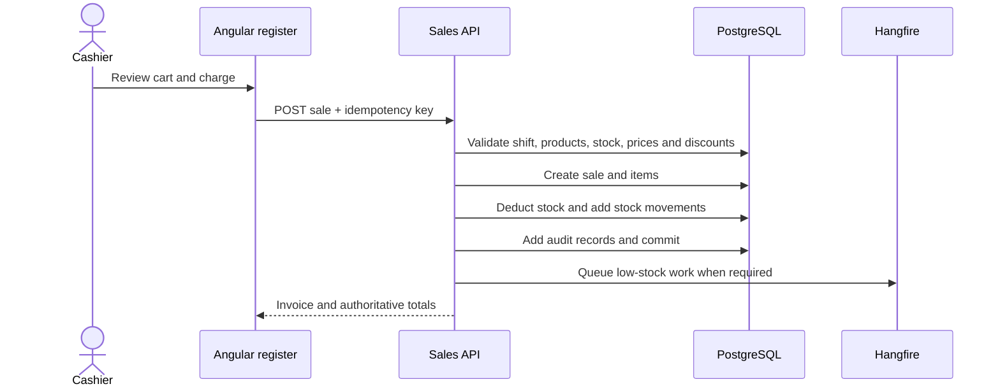
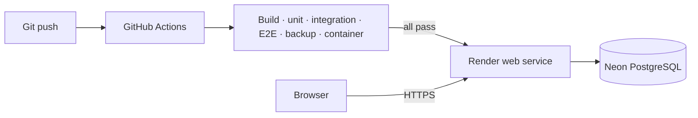

<div align="center">

# CounterPOS

### Full-stack point-of-sale, inventory, purchasing, and retail analytics platform

Built with Angular, ASP.NET Core, PostgreSQL, EF Core, Hangfire, and Docker.

[](https://github.com/ahmadislam/PosSystem/actions/workflows/ci-cd.yml)


[**Open the live demo**](https://possystem-1-26mq.onrender.com) ·
[Swagger API](https://possystem-1-26mq.onrender.com/swagger/index.html) ·
[OpenAPI JSON](https://possystem-1-26mq.onrender.com/swagger/v1/swagger.json) ·
[Health check](https://possystem-1-26mq.onrender.com/health)

**No password is required. Select “Explore live demo” on the login page.**

</div>

> The demo runs on Render's free tier and may need a short cold start. It uses synthetic portfolio data. Administrative settings are visible but read-only so every visitor receives a stable experience.

## Product tour

<p align="center">
  <a href="https://raw.githubusercontent.com/ahmadislam/PosSystem/project-demo-assets/Counter-POS-Demo.mp4">
    
  </a>
</p>

<p align="center">
  <a href="https://raw.githubusercontent.com/ahmadislam/PosSystem/project-demo-assets/Counter-POS-Demo.mp4"><strong>▶ Watch the 36-second product walkthrough</strong></a>
</p>


## Overview

CounterPOS is a production-style retail management application built to demonstrate complete transaction workflows rather than isolated CRUD screens. It combines a fast cashier register with stock control, purchasing, customer loyalty, reporting, auditability, background processing, and role-based administration.

The Angular SPA and ASP.NET Core API are shipped as one Docker image for the live demo. PostgreSQL stores business data, product images, refresh sessions, audit history, and the durable Hangfire job queue.

## Product highlights

| Area | Capabilities |
|---|---|
| **Register** | Search or scan by SKU, category filters, sticky cart, quantity controls, line discounts, coupons, tax calculation, loyalty redemption, and Cash/Card/Online payment records |
| **Cashier shifts** | Opening cash, open and pending-close states, closing cash, expected balance, and variance reconciliation |
| **Sales and returns** | Transactional checkout, idempotent retries, invoice numbering, PDF invoices, partial returns, proportional refunds, restocking, and return reasons |
| **Inventory** | Products, categories, images, suppliers, stock adjustments, minimum thresholds, soft deletion, and movement history |
| **Purchasing** | Draft, order, receive, and cancel purchase orders; receiving updates inventory and audit history atomically |
| **Customers** | Customer profiles, sale association, loyalty balances, configurable earn/redeem rules, and reversal-aware loyalty ledger |
| **Analytics** | Revenue KPIs, daily and monthly trends, top-selling products, category sales, recent invoices, and low-stock summaries |
| **Reporting** | Server-generated Excel sales and inventory reports plus downloadable PDF invoices |
| **Automation** | PostgreSQL-backed Hangfire jobs, low-stock alerts, scheduled daily/monthly summaries, and MailKit SMTP delivery |
| **Administration** | Admin, Manager, and Cashier roles; staff lifecycle controls; email settings; coupons; job status; and full audit trail |

<table>
  <tr>
    <td width="58%"></td>
    <td width="42%"></td>
  </tr>
  <tr>
    <td align="center"><strong>Fast register with a fixed checkout panel</strong></td>
    <td align="center"><strong>Print-ready PDF invoice</strong></td>
  </tr>
</table>

[Download the sample invoice PDF](docs/screenshots/sample-invoice.pdf)

## Architecture



The solution follows a Clean Architecture dependency direction:

```text
Domain <- Application <- Infrastructure <- API
                                  ^
Angular SPA ----------------------| REST/JSON
```

- **Domain** contains entities, enums, pricing rules, and return calculations.
- **Application** contains use cases, DTOs, authorization rules, and persistence abstractions.
- **Infrastructure** implements EF Core, PostgreSQL, JWT, SMTP, reports, images, and background jobs.
- **API** owns HTTP endpoints, middleware, dependency injection, health checks, and SPA hosting.
- **Web** is an Angular standalone-component application with RxJS and Chart.js.

See [architecture.md](docs/architecture.md) for the complete ERD, checkout sequence, dependency map, and deployment diagrams.

## Transaction integrity

Checkout is processed as one database transaction:



Key safeguards include:

- PostgreSQL transactions for sales, returns, purchase-order receiving, stock, loyalty, and audit records
- optimistic product concurrency through PostgreSQL `xmin`
- race-safe invoice allocation and user-scoped checkout idempotency
- global EF Core soft-delete filters for mutable business records
- indexed SKU, invoice, date, and reporting paths
- server-authoritative pricing, discounts, tax, cash tender, and change calculation

## Security model

- short-lived JWT access tokens with authorization stamps
- rotating refresh tokens stored as hashes and delivered through Secure, HttpOnly cookies
- replay detection that revokes remaining sessions
- immediate token invalidation after password, role, or account-status changes
- exact-origin validation for login, refresh, logout, and passwordless demo access
- process-level login throttling with `429` and `Retry-After`
- role policies for Admin, Manager, and Cashier workflows
- trusted-proxy configuration that rejects unsafe catch-all forwarding rules
- secrets supplied through environment variables; credentials are never committed or returned by the API

The public demo creates a dedicated Admin session with an inaccessible random password. It exposes the complete navigation and configuration view while rejecting staff, email, coupon, and loyalty configuration mutations.

## Technology stack

| Layer | Technology |
|---|---|
| Frontend | Angular 22, TypeScript 6, standalone components, RxJS, Chart.js, jsPDF |
| Backend | .NET 10, ASP.NET Core Web API, Clean Architecture |
| Data | PostgreSQL 16, Entity Framework Core, migrations and global query filters |
| Jobs and email | Hangfire with PostgreSQL storage, MailKit SMTP |
| Documents | ClosedXML server-side Excel exports and jsPDF invoice generation |
| Testing | xUnit, PostgreSQL integration tests, Vitest, Playwright |
| Delivery | Docker multi-stage build, GitHub Actions, Render, Neon |

## Repository structure

```text
PosSystem/
├── src/
│   ├── PosSystem.Domain/          # Entities and business rules
│   ├── PosSystem.Application/     # Use cases, DTOs and abstractions
│   ├── PosSystem.Infrastructure/  # EF Core, auth, reports, jobs and SMTP
│   └── PosSystem.Api/             # Controllers, middleware and composition root
├── web/                           # Angular SPA and Playwright tests
├── tests/                         # Unit, integration and SMTP test projects
├── docs/                          # API, architecture and deployment documentation
├── scripts/                       # Backup, restore and Render diagnostics tooling
├── Dockerfile                     # Combined Angular + API production image
├── docker-compose.yml             # Local PostgreSQL and optional full stack
└── render.yaml                    # Render blueprint for the portfolio deployment
```

## Run locally

### Prerequisites

- [.NET 10 SDK](https://dotnet.microsoft.com/download)
- [Node.js 22+](https://nodejs.org/) and npm
- [Docker](https://www.docker.com/) for PostgreSQL

### 1. Start PostgreSQL and the API

```bash
docker compose up -d db
dotnet restore
dotnet run --project src/PosSystem.Api --urls http://localhost:5080
```

The API applies committed EF Core migrations and seeds the development account on startup.

- Swagger: `http://localhost:5080/swagger`
- Health: `http://localhost:5080/health`
- Development login: `admin` / `Admin@12345`

### 2. Start Angular

```bash
cd web
npm ci
npm start
```

Open `http://localhost:4200`. The development proxy forwards `/api` and `/health` to the API on port `5080`.

### Docker-only option

```bash
docker compose --profile full up --build
```

The combined application is available at `http://localhost:8080`.

## Configuration

Production secrets belong in the hosting provider's secret manager.

| Variable | Purpose |
|---|---|
| `ConnectionStrings__Default` | PostgreSQL connection string |
| `Jwt__Key` | Unique signing secret with at least 32 characters |
| `Seed__AdminUsername` | Initial administrator username |
| `Seed__AdminEmail` | Initial administrator email |
| `Seed__AdminPassword` | Unique initial password with at least 12 characters |
| `DemoAccess__Enabled` | Enables the passwordless portfolio session |
| `Email__Enabled` | Enables SMTP delivery and scheduled email jobs |
| `Email__SmtpHost` / `Email__SmtpPort` | SMTP endpoint |
| `Email__Username` / `Email__Password` | SMTP credentials |
| `Email__SenderAddress` | Verified sender address |
| `ProductImages__Storage` | `Database` for hosted demos or `FileSystem` for persistent disks |

The full deployment and SMTP configuration is documented in [free-demo.md](docs/free-demo.md).

## Tests and quality gates

```bash
# Backend build and unit tests
dotnet build -c Release
dotnet test tests/PosSystem.Tests -c Release --no-build

# Frontend unit tests and production build
cd web
npm ci
npm test -- --watch=false
POS_API_ORIGIN=https://api.example.com npm run build

# Browser tests (requires the configured disposable PostgreSQL test database)
npx playwright install --with-deps chromium
npm run e2e
```

Every push is checked by GitHub Actions with six independent gates:

1. .NET build and unit tests
2. Angular tests and production build
3. PostgreSQL integration tests
4. Chromium end-to-end workflows
5. database and product-image backup/restore verification
6. production Docker image and readiness smoke test

Deployment runs only after every required job passes. See [ci-cd.md](docs/ci-cd.md) for the workflow and Render diagnostics setup.

## Deployment

The live portfolio environment uses a single Render Docker service and a Neon PostgreSQL database:



The production container builds Angular first, publishes the ASP.NET Core API, copies the SPA into `wwwroot`, and serves both from the same HTTPS origin. This avoids cross-site refresh-cookie issues and gives the demo one shareable URL.

Deployment instructions are in [free-demo.md](docs/free-demo.md). Operational backup and restore scripts are available under [`scripts/`](scripts/).

## API documentation

- [Interactive Swagger UI](https://possystem-1-26mq.onrender.com/swagger/index.html)
- [OpenAPI document](https://possystem-1-26mq.onrender.com/swagger/v1/swagger.json)
- [Endpoint and authorization reference](docs/api.md)
- [Architecture and ERD](docs/architecture.md)
- [Demo data guide](docs/demo-data.md)
- [CI/CD operations](docs/ci-cd.md)

## Payment scope

Cash, Card, and Online are recorded tender methods for POS accounting and demonstrations. The application does not claim to charge real cards or settle external wallet transactions. A production payment gateway would require provider onboarding, signed callbacks, reconciliation, and compliance work.

## Portfolio note

CounterPOS demonstrates full-stack engineering across domain modeling, transactional consistency, authentication, background processing, reporting, responsive UI design, automated testing, containerization, and cloud delivery. All records in the public environment are synthetic.
