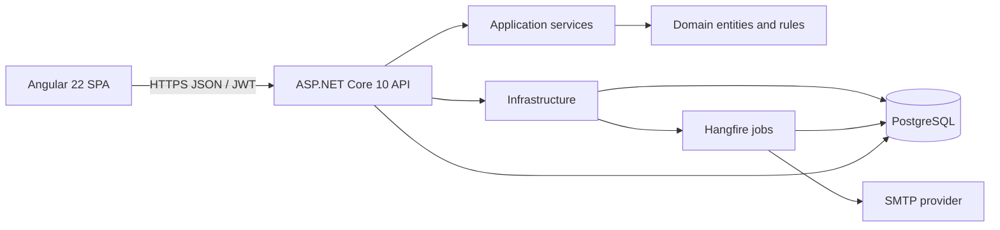
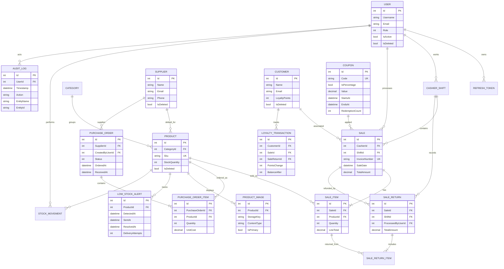

# POS System - Point of Sale, Inventory & Sales Management

ASP.NET Core 10 Web API (Clean Architecture) + PostgreSQL, with an Angular point-of-sale frontend.

## Technology stack
- **Frontend:** Angular 22, TypeScript, standalone components, RxJS, native CSS/SVG-style charts
- **Backend:** .NET 10, ASP.NET Core Web API, Clean Architecture, JWT access tokens and rotating HttpOnly refresh cookies
- **Database:** PostgreSQL with EF Core migrations, global soft-delete filters, filtered indexes, and transaction/concurrency safeguards
- **Background work and mail:** Hangfire PostgreSQL storage, MailKit SMTP, low-stock and daily/monthly sales email jobs
- **Reporting:** ClosedXML `.xlsx` sales/returns and inventory exports; downloadable invoice PDFs
- **Quality and hosting:** xUnit, Angular/Vitest, GitHub Actions, Docker API image, Vercel SPA configuration

## Current capabilities
- JWT auth with refresh-token rotation (refresh token in an HttpOnly cookie, stored hashed)
- Roles: Admin, Manager, Cashier; Admin-managed staff accounts, role changes, account disablement, and password resets
- Categories, products (search, pagination), stock adjustments with a full stock movement history
- Supplier contact management, optional product default suppliers, and purchase orders with Draft -> Ordered -> Received/Cancelled states; receiving stock, movement, and audit updates commit together
- Customer contact records, optional sale association, configurable loyalty earning/redemption, and an auditable loyalty ledger with proportional return reversals
- Manager-managed fixed/percentage coupons with UTC validity windows and redemption limits; coupons are applied after manual line discounts and before loyalty redemptions
- Product image upload, primary image selection, catalog thumbnails, and image deletion; uploads accept PNG/JPEG/WebP up to 4 MB
- Cashier shifts: Open -> PendingClose -> Closed, with cash variance
- POS sales: transactional stock deduction, race-free invoice numbers, product concurrency protection (xmin), user-scoped idempotent checkout retries
- Partial sale returns with proportional refunds, optional recorded return reasons, automatic restocking, and cash-refund shift reconciliation
- Cash tender/change calculation is a register-only cash-handling aid; Cash/Card/Online are recorded as methods and do not initiate or settle external payments
- Hangfire jobs stored in PostgreSQL: durable low-stock alert records with retry/delivery state and manager visibility, plus daily/monthly sales and inventory summaries (SMTP)
- Soft delete via EF Core global query filters, automatic audit trail (old vs new values)
- Angular POS, inventory, sales, shift, dashboard, settings, and manager-only audit/stock history screens; inventory and sales lists are paginated, and the dashboard includes daily/monthly revenue, top products, and category sales charts aggregated server-side
- Manager-only Excel report downloads with gross sales, refunds, and net totals
- Swagger UI, `/health`, global error handling, Docker, GitHub Actions CI/CD

### Authentication and session security

Refresh rotation uses a database transaction and a conditional update of the presented token.
Only one request can claim an unrevoked token; presenting a rotated token again revokes the
user's remaining refresh sessions. Refresh/logout (and login, which also issues the cookie)
require an `Origin` matching one of the exact `Cors:Origins` entries. Missing, `null`, and
unconfigured origins are rejected.

Access JWTs carry an HMAC authorization stamp derived from the user's password hash, role,
and active status. Authentication checks that stamp against the current user record on each
authorized request, so role changes, deactivation, and password resets invalidate existing
access tokens as well as refresh sessions. Staff role/status updates and password resets revoke
active refresh tokens when saved.

Login throttling is process-local: five failures for an address/username pair or twenty for an
address within a 15-minute window return `429` with `Retry-After`. For multi-instance deployments,
use a shared distributed limiter so requests cannot evade the per-process counters.

## Run locally
Prerequisites: .NET 10 SDK, Docker (or any local PostgreSQL; edit `ConnectionStrings:Default`).

```bash
./setup.sh                      # one-time: creates projects, installs packages, builds, tests, adds migration
docker compose up -d db         # PostgreSQL
dotnet run --project src/PosSystem.Api --urls http://localhost:5080
```
To run the API container with the local-only development configuration:
`docker compose --profile full up --build` (API at `http://localhost:8080`). The Compose profile
explicitly uses Development mode and disabled SMTP so it does not require production-only credentials.
Swagger: http://localhost:5080/swagger - default login `admin` / `Admin@12345` (change via `Seed__AdminPassword`).

Run the Angular app in a second terminal:

```bash
cd web
npm ci
npm start
```

The development proxy forwards `/api` and `/health` to `http://127.0.0.1:5080`; update
`web/proxy.conf.json` if you run the API on another local port.
On macOS 12, use `NG_BUILD_SASS_EMBEDDED=false npm run build` and
`NG_BUILD_SASS_EMBEDDED=false npm test -- --watch=false` to use the compatible pure-JavaScript Sass runtime.
For a production build, set `POS_API_ORIGIN` to the deployed API HTTPS origin; the build intentionally
fails instead of producing a frontend with an unset API origin.

### Email and background jobs
Local development email is disabled by default. For a deployment where email delivery is required,
set `Email__Enabled=true` and configure `Email__SmtpHost`,
`Email__SmtpPort`, `Email__SenderAddress`, and SMTP credentials (`Email__Username` and
`Email__Password`) through environment variables or your deployment's secret manager. Use
`Email__UseStartTls=true` for STARTTLS (for example, SMTP port 587), or set
`Email__UseStartTls=false` and `Email__UseSslOnConnect=true` for implicit TLS (commonly port 465).
Never commit SMTP credentials. If the SMTP provider does not require authentication, leave both
username and password blank. The API validates the server configuration at startup when email is enabled.

Sign in as Admin or Manager and open **Settings** to set the report recipient and toggle low-stock
alerts. Admins can send a test message from that page. The daily report runs at midnight UTC and
summarizes the previous UTC day; the monthly report runs at 00:15 UTC on the first day of the month
and summarizes the previous UTC calendar month. Both include gross sales, refunds, net revenue, and
low-stock inventory. Hangfire stores its queue and recurring-job state in PostgreSQL. Low-stock
alerts are queued after stock changes and require the alert toggle to be enabled.

Returns record the selected refund method for accounting; they do not initiate card or online payment
processor transactions. Cashiers can return their own sales, while Admins and Managers can return
any sale. Each return must be processed during the user's open shift.

## Architecture
`Domain` (entities, pricing rules) <- `Application` (services, DTOs, abstractions) <- `Infrastructure` (EF Core, JWT) <- `Api` (controllers, composition root).



### Entity relationship diagram



### API endpoint overview

Interactive OpenAPI documentation is available at `/swagger` on a running API.

| Area | Endpoints | Access |
|---|---|---|
| Authentication | `POST /api/auth/login`, `/refresh`, `/logout`; `GET /api/auth/me` | Public login/refresh; authenticated identity |
| Categories | `GET/POST /api/categories`, `PUT/DELETE /api/categories/{id}` | Authenticated reads; Admin/Manager writes |
| Products | `GET /api/products`, `/api/products/{id}`; `POST/PUT/DELETE /api/products`; `POST /api/products/{id}/adjust-stock` | Authenticated reads; Admin/Manager writes |
| Suppliers and purchasing | `/api/suppliers`; `/api/purchase-orders` (create, edit draft, order, receive, cancel) | Admin/Manager |
| Customers and loyalty | `/api/customers`, `/api/customers/{id}/loyalty` | Authenticated reads; Admin/Manager management |
| Coupons and loyalty rules | `/api/coupons`, `/api/coupons/available`, `/api/coupons/loyalty-rules` | Authenticated availability; Admin/Manager management |
| Product images | `/api/products/{id}/images` (list/upload), `PUT /api/products/{id}/images/{imageId}/primary`, `DELETE /api/products/{id}/images/{imageId}` | Admin/Manager |
| Product image files | `GET /api/products/{id}/images/{imageId}` | Public catalog media |
| Sales and returns | `GET/POST /api/sales`, `GET /api/sales/{id}`, `GET/POST /api/sales/{id}/returns` | Authenticated; cashier sales are scoped by service permissions |
| Low-stock alerts | `GET /api/low-stock-alerts` | Admin/Manager |
| Shifts | `GET /api/shifts/current`, `POST /api/shifts/open`, `/end`, `/close` | Authenticated |
| Dashboard | `GET /api/dashboard?from=YYYY-MM-DD&to=YYYY-MM-DD` | Admin/Manager |
| History | `GET /api/history/audit`, `/api/history/stock-movements` | Admin/Manager |
| Reports | `GET /api/reports/sales.xlsx`, `/api/reports/inventory.xlsx` | Admin/Manager |
| Staff | `GET/POST /api/staff`, `PUT /api/staff/{id}`, `/api/staff/{id}/password` | Admin |
| Email settings | `GET/PUT /api/email-settings`, `POST /api/email-settings/test` | Admin/Manager settings; Admin test mail |
| Health | `GET /health` | Public; includes database connectivity |

### Screenshots

Repository screenshots are not included yet. Capture real, non-sensitive images after configuring the
database and signing in with a demo account, then place them under `docs/screenshots/` and embed:

```markdown


```

Do not include customer data, personal email addresses, credentials, or production secrets in screenshots.

### Product image storage

Image metadata is stored in PostgreSQL and image files are stored in the directory configured by
`ProductImages__Directory`. The default is `App_Data/product-images` under the API content root.
The files are deliberately served as public catalog media so browser image requests do not need to
attach an access token; only upload and deletion require an Admin or Manager. Upload only images
intended for public display. On hosts with ephemeral filesystems, attach persistent storage and set
`ProductImages__Directory` to its mounted path, or uploaded files will not survive replacement of
the container.

## Deploy and share

This repository is deployable, but it is not published until you create provider accounts and configure
their project settings and secrets. Free-plan availability, sleep behavior, storage limits, and database
retention change by provider; check the current plan details before using a demo database for real sales.

### 1. Create PostgreSQL

Create a PostgreSQL database with a provider such as Neon or Supabase. Copy its connection string and
check the provider's guidance for SSL/pooling. The API applies EF Core migrations on startup, so use an
empty database or a compatible database previously used by this app.

### 2. Deploy the API

Create a Docker web service from this repository (for example, on Render) using the repository-root
`Dockerfile`. The container listens on port `10000`; set the service's health-check path to `/health`.
The health check verifies PostgreSQL connectivity as well as API health.
Configure these environment variables in the provider dashboard, never in source control:

| Variable | Value |
|---|---|
| `ConnectionStrings__Default` | PostgreSQL connection string |
| `Jwt__Key` | Unique random secret of at least 32 characters; the default placeholder is rejected in Production |
| `Cors__Origins__0` | Exact public Vercel origin, such as `https://your-pos.vercel.app` |
| `Seed__AdminUsername` | Initial admin username |
| `Seed__AdminEmail` | Initial admin email |
| `Seed__AdminPassword` | Unique initial admin password of at least 12 characters; the default password is rejected in Production |
| `Email__Enabled` | `true` to enable SMTP alerts/reports, or `false` to run without email |
| `Email__SmtpHost` | SMTP hostname from your email provider |
| `Email__SmtpPort` | Provider SMTP port (commonly `587` with STARTTLS) |
| `Email__SenderAddress` | Verified sender address allowed by your provider |
| `Email__Username` / `Email__Password` | Provider SMTP credentials stored as secrets; leave both empty only if SMTP does not require authentication |
| `Email__UseStartTls` | `true` for STARTTLS; `false` for implicit TLS |
| `Email__UseSslOnConnect` | `false` for STARTTLS; `true` for implicit TLS (commonly port `465`) |

SMTP is optional; the API starts with email disabled, but report and low-stock email jobs are not
scheduled. If email is enabled, invalid SMTP settings fail startup. Obtain the hostname, port,
TLS mode, sender verification, and credentials from your SMTP provider (for example, use a provider
issued SMTP credential or an app password where supported; do not use your normal mailbox password).
Keep credentials in the hosting provider's secret environment-variable settings. After deployment,
open Settings, save a valid manager email recipient, and use **Send test email** before relying on
scheduled reports or alerts. The Excel download remains available even if SMTP is temporarily
unavailable after startup.

After the first healthy API deployment, verify `/health` and `/swagger`, then sign in with the initial
admin credentials. Create personal Admin and Manager accounts in Settings as needed, confirm they can
sign in, then disable the default seeded account if you changed the initial login configuration.
Do not share the seeded password publicly.

### 3. Deploy the Angular app

Import the repository as a Vercel project with root directory `web` and output directory
`dist/web/browser`. Configure the project build environment variable `POS_API_ORIGIN` to the exact
deployed API origin (HTTPS origin only, no path or trailing slash). `npm run build` fails if it is
missing or invalid and generates a runtime config containing that origin; the committed frontend
contains no deployment placeholder. API requests use that absolute origin, so they cannot be
mistakenly served as SPA fallback HTML by Vercel. The Angular SPA rewrite remains for frontend routes.

Set `Cors__Origins__0` on the API to the exact public Vercel origin, then redeploy the API. Refresh
tokens are Secure, HttpOnly cookies; browser refresh/logout additionally require an allowed Origin.
The default Vercel and Render hostnames are different sites, and some browsers block third-party
cookies regardless of `SameSite=None`. For dependable refresh cookies, use custom app/API hostnames
under the same registrable domain (for example, `app.example.com` and `api.example.com`) and configure
the corresponding exact CORS/Origin entry. Cross-site cookie behavior must be tested in target browsers.

Open the public Vercel URL and sign in with an Admin account to configure categories/products and
demonstrate the POS. The API and database must both remain available for the demo.

### 4. CI-gated deploys

GitHub Actions runs the .NET build/tests and Angular tests/production build on Ubuntu for every pull
request and push to `main`. Local macOS Sass limitations do not affect that Linux build.
For an API deployment only after both CI jobs pass, disable Render's automatic deploy and configure
the repository Actions secret `RENDER_DEPLOY_HOOK`. For the frontend, disable Vercel's automatic Git
deploy and configure a Vercel Deploy Hook as the repository Actions secret `VERCEL_DEPLOY_HOOK`.
The deploy job runs only for a push to `main`, after API and web build/test jobs succeed. If a hook
is absent, that hosting deploy is skipped; the deployment provider, API/database, SMTP, CORS, and
secrets must still be separately configured. These repository files do not mean a provider account
or live deployment exists.

Deploy a clean baseline on the default branch first. Do not put database URLs, JWT keys, SMTP passwords,
or deploy hooks in committed files or screenshots.

### Database backup and restore

Install PostgreSQL client tools matching the hosted PostgreSQL major version. Store the database URL
in an environment variable or secret manager, not in shell history or source files:

```bash
export DATABASE_URL='postgresql://...'
./scripts/backup-database.sh ./backups/pos-$(date -u +%Y%m%dT%H%M%SZ).dump
```

Restore only to a disposable or intentionally selected target. The restore script prompts before
replacing objects; run EF migrations and verify `/health` after restoring:

```bash
export DATABASE_URL='postgresql://...disposable-target...'
./scripts/restore-database.sh ./backups/pos-backup.dump
```

The custom-format dump supports `pg_restore --list` for inspection. Keep encrypted/offsite copies
according to your retention policy, and test restores periodically without using production as the
test target.