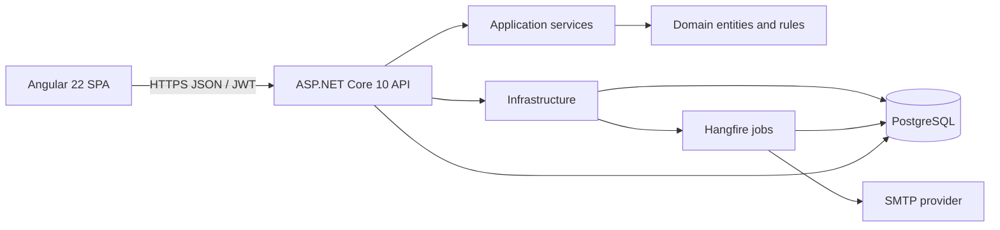
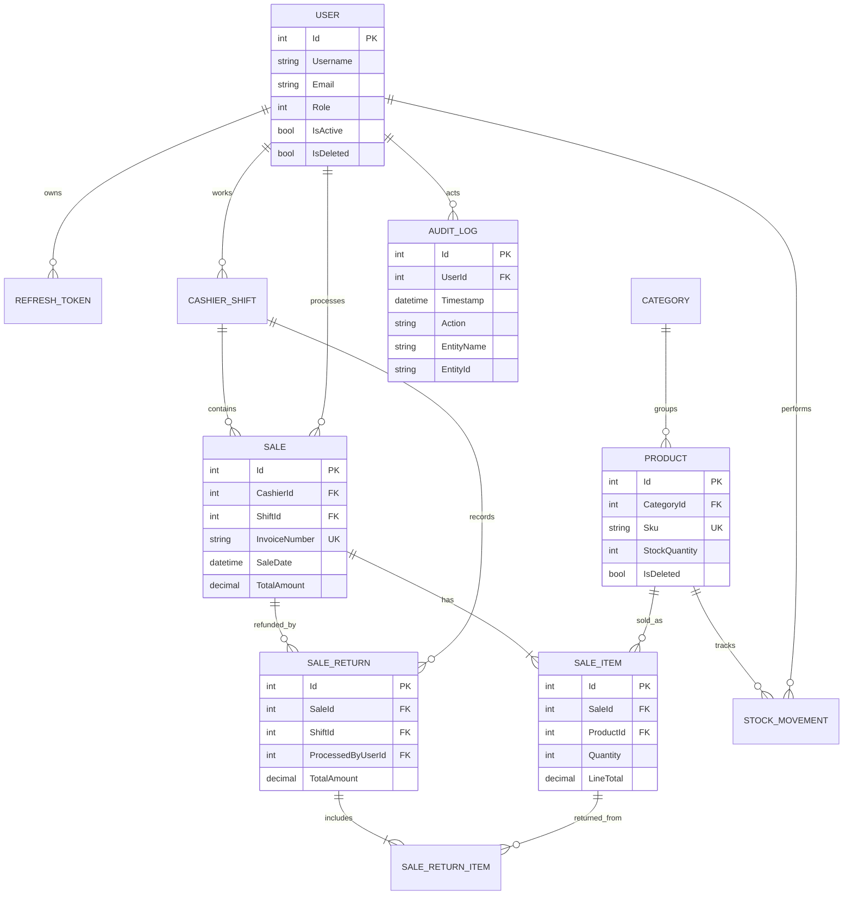

# POS System - Point of Sale, Inventory & Sales Management

ASP.NET Core 10 Web API (Clean Architecture) + PostgreSQL, with an Angular point-of-sale frontend.

## Product demo

<p align="center">
  <a href="https://raw.githubusercontent.com/ahmadislam/PosSystem/project-demo-assets/Counter-POS-Demo.mp4">
    
  </a>
</p>

<p align="center">
  <a href="https://raw.githubusercontent.com/ahmadislam/PosSystem/project-demo-assets/Counter-POS-Demo.mp4"><strong>▶ Watch the full 36-second product demo</strong></a>
</p>

## Technology stack
- **Frontend:** Angular 22, TypeScript, standalone components, RxJS, native CSS/SVG-style charts
- **Backend:** .NET 10, ASP.NET Core Web API, Clean Architecture, JWT access tokens and rotating HttpOnly refresh cookies
- **Database:** PostgreSQL with EF Core migrations, global soft-delete filters, filtered indexes, and transaction/concurrency safeguards
- **Background work and mail:** Hangfire PostgreSQL storage, MailKit SMTP, low-stock and daily/monthly sales email jobs
- **Reporting:** ClosedXML `.xlsx` sales/returns and inventory exports; print-friendly invoice view
- **Quality and hosting:** xUnit, Angular/Vitest, GitHub Actions, Docker API image, Vercel SPA configuration

## Current capabilities
- JWT auth with refresh-token rotation (refresh token in an HttpOnly cookie, stored hashed)
- Roles: Admin, Manager, Cashier; Admin-managed staff accounts, role changes, account disablement, and password resets
- Categories, products (search, pagination), stock adjustments with a full stock movement history
- Cashier shifts: Open -> PendingClose -> Closed, with cash variance
- POS sales: transactional stock deduction, race-free invoice numbers, concurrency protection (xmin)
- Partial sale returns with proportional refunds, automatic restocking, and cash-refund shift reconciliation
- Hangfire jobs stored in PostgreSQL: low-stock email alerts and daily/monthly sales and inventory summaries (SMTP), with an admin test-email flow and manager-recipient settings
- Soft delete via EF Core global query filters, automatic audit trail (old vs new values)
- Angular POS, inventory, sales, shift, dashboard, settings, and manager-only audit/stock history screens; inventory and sales lists are paginated, and the dashboard includes daily/monthly revenue, top products, and category sales charts aggregated server-side
- Manager-only Excel report downloads with sales, returns, and net totals
- Swagger UI, `/health`, global error handling, Docker, GitHub Actions CI/CD

## Run locally
Prerequisites: .NET 10 SDK, Docker (or any local PostgreSQL; edit `ConnectionStrings:Default`).

```bash
./setup.sh                      # one-time: creates projects, installs packages, builds, tests, adds migration
docker compose up -d db         # PostgreSQL
dotnet run --project src/PosSystem.Api --urls http://localhost:5080
```
Swagger: http://localhost:5080/swagger - default login `admin` / `Admin@12345` (change via `Seed__AdminPassword`).

Run the Angular app in a second terminal:

```bash
cd web
npm ci
npm start
```

The development proxy forwards `/api` and `/health` to `http://127.0.0.1:5080`; update
`web/proxy.conf.json` if you run the API on another local port.
On macOS 12, use `NG_BUILD_SASS_EMBEDDED=false npm run build` and
`NG_BUILD_SASS_EMBEDDED=false npm test -- --watch=false` to use the compatible pure-JavaScript Sass runtime.

### Email and background jobs
Local development email is disabled by default. For a deployment where email delivery is required,
set `Email__Enabled=true` and configure `Email__SmtpHost`,
`Email__SmtpPort`, `Email__SenderAddress`, and SMTP credentials (`Email__Username` and
`Email__Password`) through environment variables or your deployment's secret manager. Use
`Email__UseStartTls=true` for STARTTLS (for example, SMTP port 587), or set
`Email__UseStartTls=false` and `Email__UseSslOnConnect=true` for implicit TLS (commonly port 465).
Never commit SMTP credentials. If the SMTP provider does not require authentication, leave both
username and password blank. The API validates the server configuration at startup when email is enabled.

Sign in as Admin or Manager and open **Settings** to set the report recipient and toggle low-stock
alerts. Admins can send a test message from that page. The daily report runs at midnight UTC and
summarizes the previous UTC day; the monthly report runs at 00:15 UTC on the first day of the month
and summarizes the previous UTC calendar month. Both include gross sales, refunds, net revenue, and
low-stock inventory. Hangfire stores its queue and recurring-job state in PostgreSQL. Low-stock
alerts are queued after stock changes and require the alert toggle to be enabled.

Returns record the selected refund method for accounting; they do not initiate card or online payment
processor transactions. Cashiers can return their own sales, while Admins and Managers can return
any sale. Each return must be processed during the user's open shift.

## Architecture
`Domain` (entities, pricing rules) <- `Application` (services, DTOs, abstractions) <- `Infrastructure` (EF Core, JWT) <- `Api` (controllers, composition root).



### Entity relationship diagram



### API endpoint overview

Interactive OpenAPI documentation is available at `/swagger` on a running API.

| Area | Endpoints | Access |
|---|---|---|
| Authentication | `POST /api/auth/login`, `/refresh`, `/logout`; `GET /api/auth/me` | Public login/refresh; authenticated identity |
| Categories | `GET/POST /api/categories`, `PUT/DELETE /api/categories/{id}` | Authenticated reads; Admin/Manager writes |
| Products | `GET /api/products`, `/api/products/{id}`; `POST/PUT/DELETE /api/products`; `POST /api/products/{id}/adjust-stock` | Authenticated reads; Admin/Manager writes |
| Sales and returns | `GET/POST /api/sales`, `GET /api/sales/{id}`, `GET/POST /api/sales/{id}/returns` | Authenticated; cashier sales are scoped by service permissions |
| Shifts | `GET /api/shifts/current`, `POST /api/shifts/open`, `/end`, `/close` | Authenticated |
| Dashboard | `GET /api/dashboard?from=YYYY-MM-DD&to=YYYY-MM-DD` | Admin/Manager |
| History | `GET /api/history/audit`, `/api/history/stock-movements` | Admin/Manager |
| Reports | `GET /api/reports/sales.xlsx`, `/api/reports/inventory.xlsx` | Admin/Manager |
| Staff | `GET/POST /api/staff`, `PUT /api/staff/{id}`, `/api/staff/{id}/password` | Admin |
| Email settings | `GET/PUT /api/email-settings`, `POST /api/email-settings/test` | Admin/Manager settings; Admin test mail |
| Health | `GET /health` | Public; includes database connectivity |

### Screenshots

Repository screenshots are not included yet. Capture real, non-sensitive images after configuring the
database and signing in with a demo account, then place them under `docs/screenshots/` and embed:

```markdown


```

Do not include customer data, personal email addresses, credentials, or production secrets in screenshots.

## Deploy and share

This repository is deployable, but it is not published until you create provider accounts and configure
their project settings and secrets. Free-plan availability, sleep behavior, storage limits, and database
retention change by provider; check the current plan details before using a demo database for real sales.

### 1. Create PostgreSQL

Create a PostgreSQL database with a provider such as Neon or Supabase. Copy its connection string and
check the provider's guidance for SSL/pooling. The API applies EF Core migrations on startup, so use an
empty database or a compatible database previously used by this app.

### 2. Deploy the API

Create a Docker web service from this repository (for example, on Render) using the repository-root
`Dockerfile`. The container listens on port `10000`; set the service's health-check path to `/health`.
The health check verifies PostgreSQL connectivity as well as API health.
Configure these environment variables in the provider dashboard, never in source control:

| Variable | Value |
|---|---|
| `ConnectionStrings__Default` | PostgreSQL connection string |
| `Jwt__Key` | Unique random secret of at least 32 characters; the default placeholder is rejected in Production |
| `Cors__Origins__0` | Exact public Vercel origin, such as `https://your-pos.vercel.app` |
| `Seed__AdminUsername` | Initial admin username |
| `Seed__AdminEmail` | Initial admin email |
| `Seed__AdminPassword` | Unique initial admin password of at least 12 characters; the default password is rejected in Production |
| `Email__Enabled` | `true` (production API startup requires SMTP enabled) |
| `Email__SmtpHost` | SMTP hostname from your email provider |
| `Email__SmtpPort` | Provider SMTP port (commonly `587` with STARTTLS) |
| `Email__SenderAddress` | Verified sender address allowed by your provider |
| `Email__Username` / `Email__Password` | Provider SMTP credentials stored as secrets; leave both empty only if SMTP does not require authentication |
| `Email__UseStartTls` | `true` for STARTTLS; `false` for implicit TLS |
| `Email__UseSslOnConnect` | `false` for STARTTLS; `true` for implicit TLS (commonly port `465`) |

SMTP configuration is required for Production; the API intentionally refuses to start if
`Email__Enabled` is false or the enabled SMTP settings fail validation. Obtain the hostname, port,
TLS mode, sender verification, and credentials from your SMTP provider (for example, use a provider
issued SMTP credential or an app password where supported; do not use your normal mailbox password).
Keep credentials in the hosting provider's secret environment-variable settings. After deployment,
open Settings, save a valid manager email recipient, and use **Send test email** before relying on
scheduled reports or alerts. The Excel download remains available even if SMTP is temporarily
unavailable after startup.

After the first healthy API deployment, verify `/health` and `/swagger`, then sign in with the initial
admin credentials. Create personal Admin and Manager accounts in Settings as needed, confirm they can
sign in, then disable the default seeded account if you changed the initial login configuration.
Do not share the seeded password publicly.

### 3. Deploy the Angular app

Import the same Git repository as a Vercel project and set the project root to `web`. Use
`npm run build` as the build command and `dist/web/browser` as the output directory. The included
`web/vercel.json` routes Angular deep links back to the SPA entry point.

Before the first production deployment, edit
[`web/src/environments/environment.production.ts`](./web/src/environments/environment.production.ts)
and replace the placeholder `apiUrl` with the deployed API origin (no trailing slash), then commit and
push the change. Set `Cors__Origins__0` on the API to the exact Vercel origin shown by Vercel, redeploy
the API, and redeploy the frontend. If Vercel assigns a different production domain later, update CORS
and redeploy the API.

Open the public Vercel URL and sign in with an Admin account to configure categories/products and
demonstrate the POS. The API and database must both remain available for the demo.

### 4. CI and optional API auto-deploy

GitHub Actions runs the .NET build/tests and Angular tests/production build on Ubuntu for every pull
request and push to `main`. Local macOS Sass limitations do not affect that Linux build.
To trigger a Render deployment after both jobs pass, disable Render's automatic deploy and add a
repository Actions secret named `RENDER_DEPLOY_HOOK`. If the secret is omitted, CI still passes and
simply skips the optional API deploy. Vercel can deploy from its Git integration after the successful
push; configure Vercel to deploy the `main` branch.

Deploy a clean baseline on the default branch first. Do not put database URLs, JWT keys, SMTP passwords,
or deploy hooks in committed files or screenshots.
