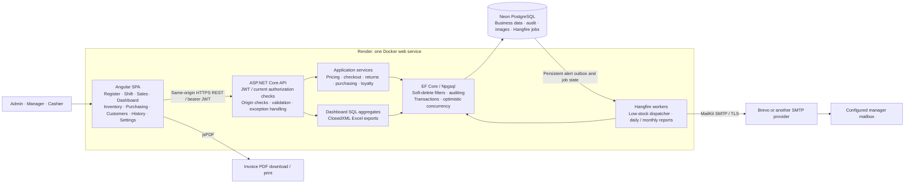
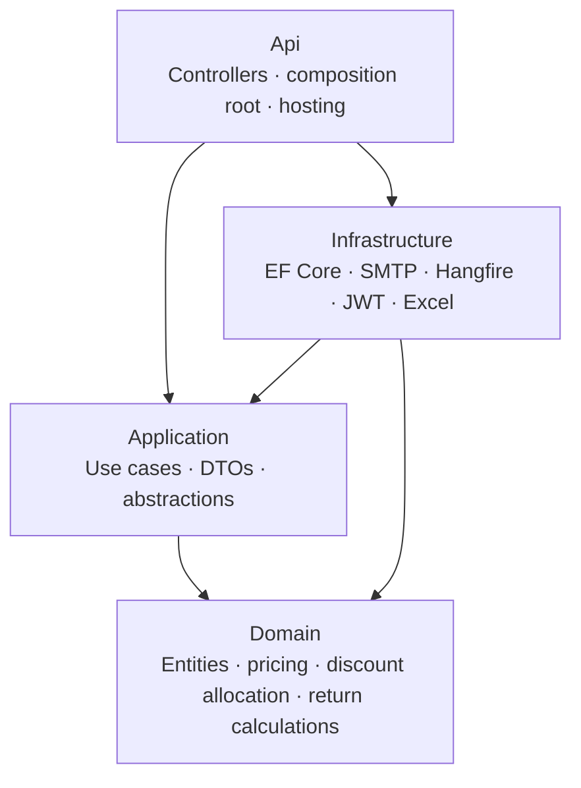
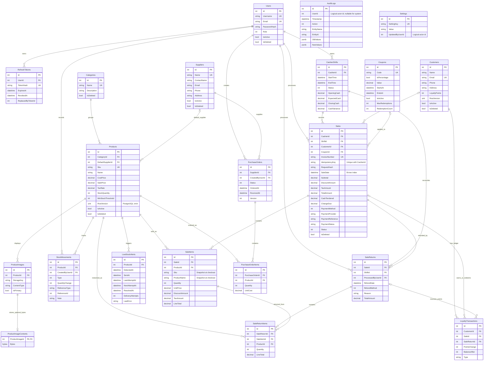
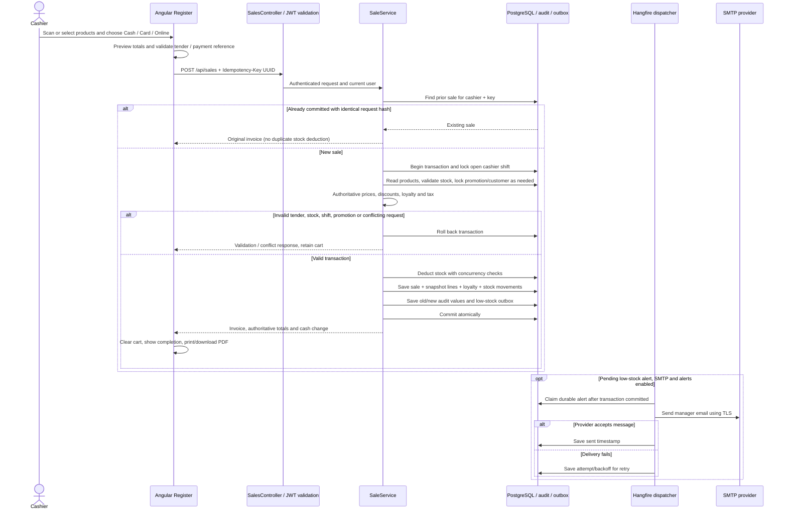
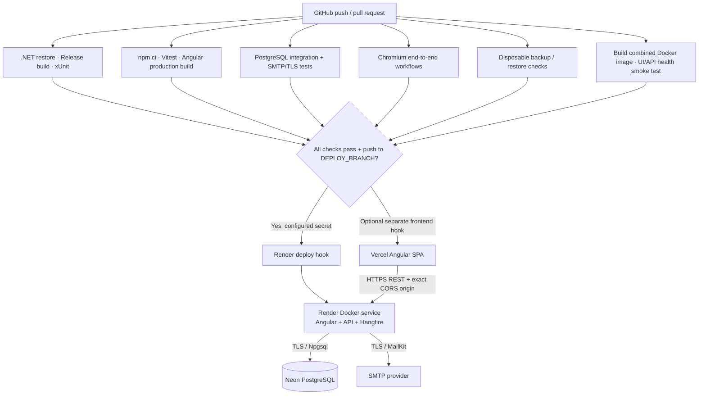

# POS architecture and data model

These diagrams describe the repository's implemented Angular 22 / ASP.NET Core 10 system.
The database is **PostgreSQL**, including the Neon deployment. SQL Server's “non-clustered
index” terminology is represented here by PostgreSQL B-tree indexes; a database-engine
migration is not required to satisfy the indexing objective.

## System architecture

The Docker image builds and serves both frontend and API. `ClientHosting` serves Angular routes
but never converts unknown `/api`, `/health`, or `/swagger` routes into SPA HTML. Separate
Vercel hosting is also supported through `POS_API_ORIGIN` and exact CORS origins.
Free hosts may sleep: durable jobs survive restarts, but cannot execute while the API is asleep.

## Clean Architecture dependencies

## Entity relationship diagram

Column names match the current entities and migrations. `CreatedAt` / `UpdatedAt` inherited
from `BaseEntity` are omitted for readability. Flags are shown only where soft deletion is
implemented: users, categories, suppliers, products, customers, and sales. Financial line
items, returns, stock movements, loyalty entries, and audit records retain history.

`AuditLogs.UserId` and `Settings.UpdatedByUserId` are logical actor identifiers, not enforced
foreign keys in the current model. `StockMovements.ReferenceType/ReferenceId` and
`RefreshTokens.ReplacedByTokenId` likewise do not establish additional database foreign keys.
The separate `hangfire` schema contains Hangfire-managed job tables.

## Checkout and payment sequence

Card and online methods **record a provider/reference**, including Easypaisa and JazzCash;
they do not execute a gateway charge. Cash validates tender and persists change. SMTP delivery
occurs after commit, so a mail failure cannot undo a completed sale. Mail delivery and database
state cannot form one distributed transaction; a worker failure after SMTP acceptance can
produce a repeated message on retry.

## Deployment and CI/CD

Hook secrets must be configured by a repository administrator, and provider Git auto-deploy
must be disabled for the CI gate to control releases. See [CI/CD setup](ci-cd.md) for branch
selection, required secrets, and the difference between a successful hook request and a
healthy deployment. No credentials are stored in these diagrams.
